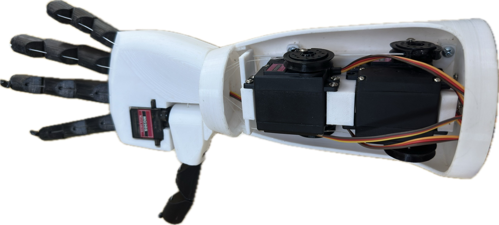
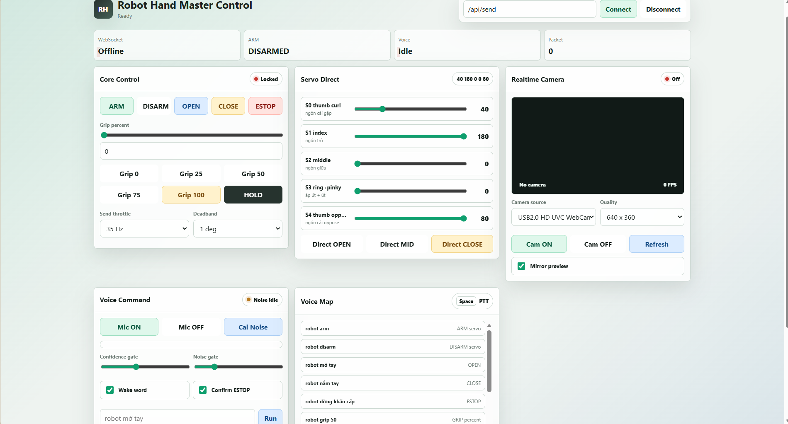
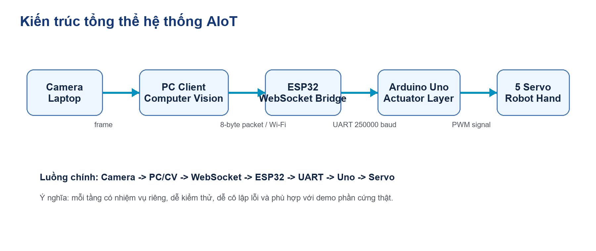
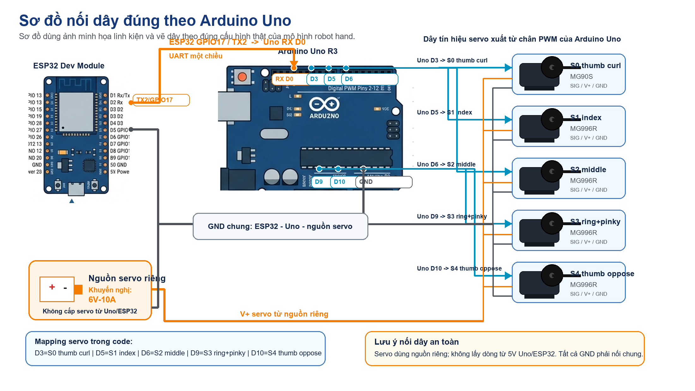
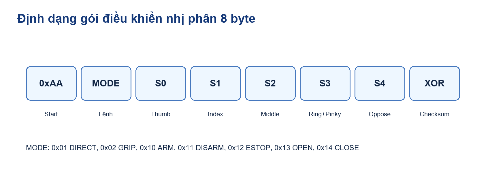
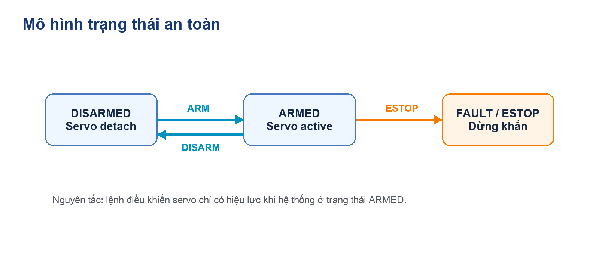
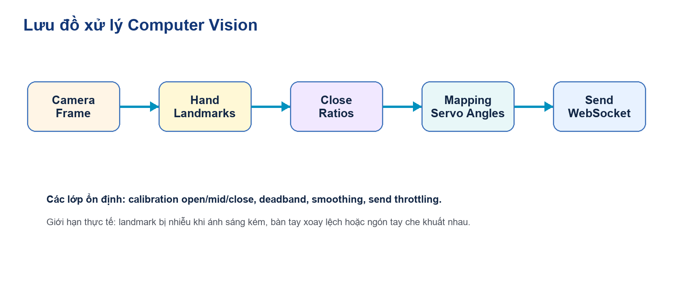
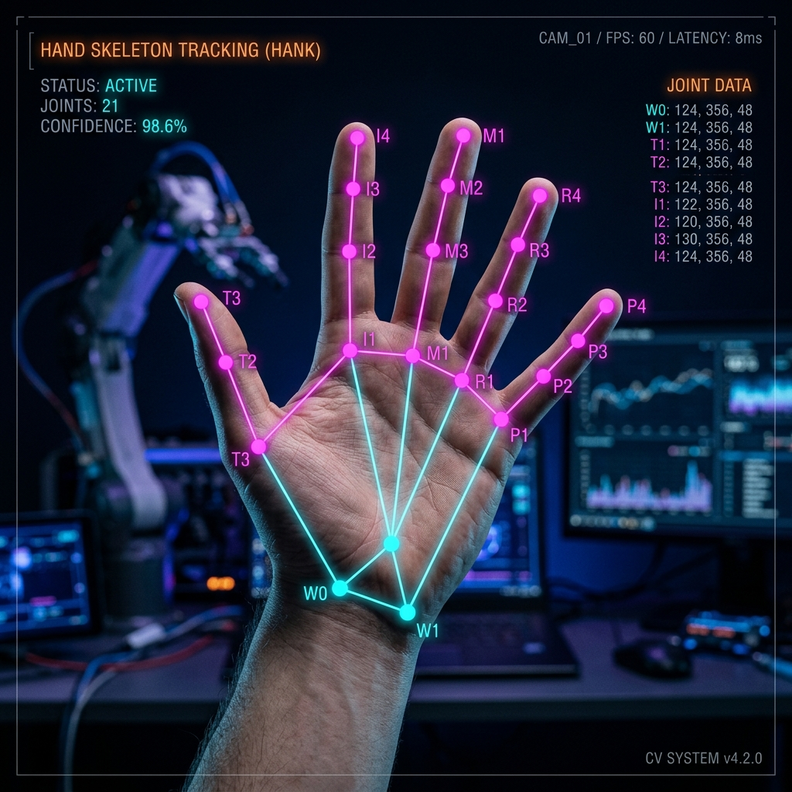
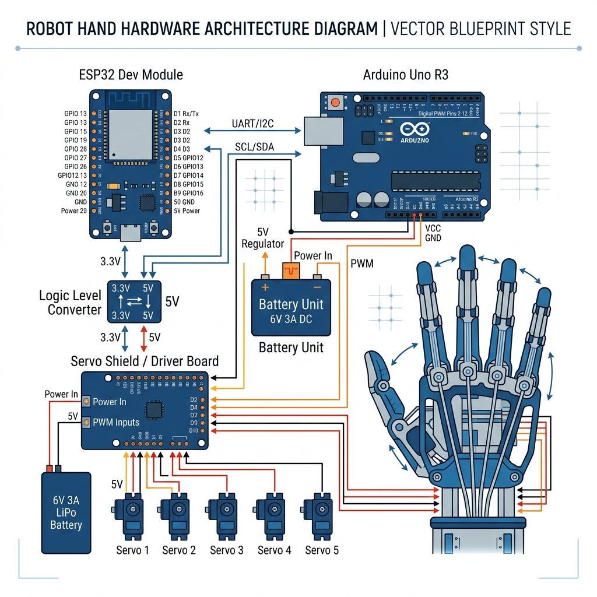

> **BAN HIEN TAI (2026-10-15):** Doc [README_6SERVO_D8_UPDATE.md](README_6SERVO_D8_UPDATE.md) truoc. Noi dung ben duoi la tai lieu lich su 5 servo, KHONG ap dung cho firmware 6 servo moi.

<div align="center">

# Vision-Driven Robot Hand

### A realtime AIoT pipeline that turns human hand motion into physical robot-hand motion

<p>
  
  
  
  
</p>

<p>
  
  
  
  
</p>

<p>
  <a href="web_poster/poster_full_vector.pdf">
    
  </a>
</p>

<p>
  <b>Camera sees.</b>
  <b>PC interprets.</b>
  <b>ESP32 relays.</b>
  <b>Arduino executes.</b>
  <b>Robot hand moves.</b>
</p>

</div>

## Why This Project Matters

Most student AI projects stop at prediction.

Most embedded demos stop at manual control.

This project closes the full loop:

- live camera perception
- pose-to-servo translation
- compact realtime packet transport
- ESP32 bridge communication
- Arduino-based actuation
- physical tendon-driven robot hand motion

That end-to-end path is the reason this repository feels more like a real system than a classroom prototype.

## Quick View

| Area | Value |
| --- | --- |
| Physical output | Drives real servos, not simulation |
| AIoT architecture | Vision -> transport -> embedded -> actuator |
| Operator modes | CV, dashboard, voice command |
| Safety logic | `ARM`, `DISARM`, `ESTOP`, preview-first workflow |
| Transport design | Deterministic fixed 8-byte packet |
| Demo strength | Clear live workflow and test-first debugging path |

## Poster And Visuals

| Official Poster | Operator Dashboard |
| --- | --- |
| [Open `poster_full_vector.pdf`](web_poster/poster_full_vector.pdf) |  |

| Real Robot Hand | System Architecture |
| --- | --- |
|  |  |

## Technical Gallery

| Hardware Wiring | Packet Format |
| --- | --- |
|  |  |

| Safety State Machine | CV Algorithm |
| --- | --- |
|  |  |

| Skeleton Preview | Hardware Reference |
| --- | --- |
|  |  |

## Core Experience

```text
Your hand moves
-> the camera captures it
-> the PC interprets it
-> the ESP32 relays it
-> the Arduino executes it
-> the robot hand responds
```

## Full Live Pipeline

```text
Camera / Voice / Dashboard
-> PC client or browser UI
-> Binary packet (8 bytes)
-> ESP32 WebSocket bridge
-> UART2 TX2 GPIO17
-> Arduino Uno RX D0
-> 5-servo tendon-driven robot hand
```

## Table Of Contents

- [Vietnamese](#vietnamese)
- [English](#english)
- [Project Assets](#project-assets)
- [License](#license)

---

## Vietnamese

### Tổng quan

`Vision-Driven Robot Hand` là dự án AIoT điều khiển bàn tay robot 5 bậc tự do theo thời gian thực, trong đó chuyển động bàn tay người được camera ghi nhận, xử lý trên PC, đóng gói thành lệnh nhị phân, truyền qua ESP32 và thực thi trên Arduino Uno để điều khiển cụm servo thật.

Poster chính thức của dự án được dùng ở dạng vector PDF:

- [`web_poster/poster_full_vector.pdf`](web_poster/poster_full_vector.pdf)

Điểm mạnh của dự án là đi hết chuỗi triển khai AI tới phần cứng thật:

- perception bằng Computer Vision
- điều khiển bằng dashboard web và voice command
- truyền lệnh realtime bằng WebSocket và UART
- bridge nhúng bằng ESP32
- chấp hành cuối bằng Arduino Uno và servo thật

### Điểm nổi bật

| Hạng mục | Giá trị |
| --- | --- |
| Real hardware control | Bàn tay robot thật chuyển động theo lệnh thật |
| End-to-end AIoT | Không dừng ở model hay camera preview |
| Kiến trúc nhiều lớp | Dễ test, debug, demo và bàn giao |
| Workflow an toàn | Có `ARM`, `DISARM`, `ESTOP`, link test và preview |
| Protocol gọn | Packet 8 byte phù hợp cho embedded control |
| Portfolio mạnh | Thể hiện rõ AI ứng dụng, embedded và systems integration |

### Khả năng hiện tại

| Thành phần | Khả năng hiện có |
| --- | --- |
| Robot hand | `OPEN`, `CLOSE`, `GRIP`, direct servo angles, hold pose |
| Computer vision | Theo dõi hand skeleton, calibration, preview, realtime send |
| Web dashboard | Connect, ARM/DISARM, grip slider, direct servo sliders, camera preview |
| Voice control | Lệnh cơ bản như open hand, close hand, arm, disarm, estop |
| Debugging | Link test, packet test, protocol reference, hardware checklist |

### Gallery kỹ thuật

| Mô hình thật | Dashboard |
| --- | --- |
|  |  |

| Kiến trúc hệ thống | Wiring phần cứng |
| --- | --- |
|  |  |

| State machine an toàn | CV skeleton |
| --- | --- |
|  |  |

### Kiến trúc hệ thống

#### 1. Computer Vision Layer

- Đọc camera và theo dõi bàn tay người
- Chuyển pose thành góc servo
- Preview an toàn trước khi gửi lệnh thật
- Gửi packet realtime khi hệ thống sẵn sàng

File chính:

- [`pc_client/cv_sender_template.py`](pc_client/cv_sender_template.py)

#### 2. Web Control Layer

- Dashboard điều khiển trực tiếp
- `ARM`, `DISARM`, `ESTOP`
- `OPEN`, `CLOSE`, `GRIP`
- Direct control từng servo
- Camera preview và local bridge an toàn cho browser

File chính:

- [`web_client/master_control.html`](web_client/master_control.html)
- [`web_client/master_control_server.py`](web_client/master_control_server.py)

#### 3. ESP32 Bridge Layer

- Tạo AP `RobotHand_ESP32`
- Host WebSocket server ở port `81`
- Kiểm tra `start byte` và `checksum`
- Forward packet sang Uno qua `Serial2`

Firmware:

- [`firmware/esp32_ws_bridge/esp32_robot_hand_ws_bridge/esp32_robot_hand_ws_bridge.ino`](firmware/esp32_ws_bridge/esp32_robot_hand_ws_bridge/esp32_robot_hand_ws_bridge.ino)

#### 4. Actuator Layer

- Nhận packet 8 byte từ ESP32
- Quản lý `DISARMED`, `ARMED`, `ESTOP`
- Thực thi `OPEN`, `CLOSE`, `GRIP`, `DIRECT`
- Điều khiển 5 servo theo calibration cố định

Firmware:

- [`firmware/arduino_uno/robot_hand_uno_realtime_final/robot_hand_uno_realtime_final.ino`](firmware/arduino_uno/robot_hand_uno_realtime_final/robot_hand_uno_realtime_final.ino)

### Phần cứng

#### Linh kiện

- 1 ESP32
- 1 Arduino Uno
- 1 MG90S
- 4 MG996R
- 1 nguồn servo riêng `5V-6V`

#### Servo mapping

```text
S0 thumb curl    -> Uno D3
S1 index         -> Uno D5
S2 middle        -> Uno D6
S3 ring          -> Uno D9
S4 thumb oppose  -> Uno D10
```

#### UART wiring

```text
ESP32 GPIO17 / TX2 -> Uno RX D0
ESP32 GND          -> Uno GND
```

#### Quy tắc cấp nguồn servo

- Dùng nguồn servo riêng
- Không cấp cả cụm servo từ chân `5V` của Uno hoặc ESP32
- Khuyến nghị tối thiểu `6V 10A`
- Nối chung tất cả GND: servo PSU, Uno, ESP32

### Locked Calibration

```text
OPEN  = {40, 180, 0,   0,   80}
CLOSE = {170, 0,   180, 180, 0}
```

Đây là calibration bắt buộc phải đồng bộ giữa firmware, PC client và dashboard.

### Khởi động nhanh

```powershell
.\setup_python_env.bat
.\run_link_test.bat
.\run_master_control.bat
.\run_preview_cv.bat
.\run_realtime_cv.bat
```

### Các chế độ vận hành

#### Master Control Dashboard

Mode đầy đủ nhất để demo và vận hành thực tế.

#### CV Preview Only

Mode an toàn để kiểm tra landmark và mapping mà không tác động lên phần cứng.

#### CV Realtime Control

Chỉ chạy khi link test đã pass và phần cứng đã sẵn sàng.

#### Link Test

Kiểm tra trực tiếp tuyến `PC -> WebSocket -> ESP32 -> UART -> Uno`.

### Giao thức truyền thông

```text
Byte 0: 0xAA
Byte 1: mode
Byte 2..6: payload
Byte 7: XOR checksum của byte 0..6
```

Modes:

```text
0x01 = direct angles
0x02 = grip percent
0x10 = ARM
0x11 = DISARM
0x12 = ESTOP
0x13 = OPEN
0x14 = CLOSE
```

Chi tiết thêm:

- [`docs/protocol.md`](docs/protocol.md)
- [`tools/make_packet_reference.py`](tools/make_packet_reference.py)

### Trình tự demo nên dùng

1. Giới thiệu phần cứng và quy tắc cấp nguồn.
2. Giải thích pipeline `PC -> ESP32 -> Uno -> Servo`.
3. Chạy `link test`.
4. Mở dashboard và điều khiển trực tiếp từng servo.
5. Chạy `CV preview`.
6. Chạy `CV realtime`.
7. Kết thúc bằng grip presets hoặc voice command.

### Tài liệu quan trọng

- [`QUICKSTART.md`](QUICKSTART.md)
- [`HANDOVER.md`](HANDOVER.md)
- [`HARDWARE_CHECKLIST.md`](HARDWARE_CHECKLIST.md)
- [`KNOWN_ISSUES.md`](KNOWN_ISSUES.md)
- [`docs/calibration.md`](docs/calibration.md)
- [`docs/realtime_notes.md`](docs/realtime_notes.md)

### Kết luận ngắn

Đây là kiểu dự án nhìn đẹp trên portfolio, nhưng giá trị lớn hơn là nó chứng minh được năng lực systems integration thực sự: AI, protocol, embedded, safety và motion cùng gặp nhau trên một hệ thống có thể chạy thật.

---

## English

### Overview

`Vision-Driven Robot Hand` is a real-time AIoT project that maps human hand motion to a physical 5-servo robot hand. Camera input is processed on the PC, converted into compact binary control packets, transmitted through ESP32, and executed by Arduino Uno on real hardware.

The official project poster is provided as a vector PDF:

- [`web_poster/poster_full_vector.pdf`](web_poster/poster_full_vector.pdf)

Its strength is not just visual tracking. Its strength is that the entire chain reaches the real actuator layer:

- perception through computer vision
- operator control through a dashboard and voice commands
- realtime transport through WebSocket and UART
- embedded bridging through ESP32
- final actuation through Arduino Uno and real servos

### Highlights

| Area | Why it matters |
| --- | --- |
| Real hardware control | Moves actual servos instead of stopping at simulation |
| AI-to-actuator pipeline | Reaches physical execution, not just model output |
| Layered structure | Easier to test, debug, and demonstrate |
| Safety-first workflow | Includes `ARM`, `DISARM`, `ESTOP`, link testing, and safe preview |
| Compact protocol | Uses a deterministic 8-byte packet suited to embedded control |
| Strong portfolio value | Demonstrates applied AI, embedded integration, and systems thinking |

### Current capabilities

| Component | Current capability |
| --- | --- |
| Robot hand | `OPEN`, `CLOSE`, `GRIP`, direct servo control, hold pose |
| Computer vision | Hand skeleton tracking, calibration, preview, realtime sending |
| Web dashboard | Connect, ARM/DISARM, grip slider, direct servo sliders, camera preview |
| Voice control | Basic commands such as open hand, close hand, arm, disarm, estop |
| Debugging | Link test, packet test, protocol reference, hardware checklist |

### Technical gallery

| Real Build | Dashboard |
| --- | --- |
|  |  |

| System Architecture | Hardware Wiring |
| --- | --- |
|  |  |

| Safety State Machine | CV Skeleton |
| --- | --- |
|  |  |

### Layered architecture

#### 1. Computer Vision Layer

- Reads camera input
- Tracks the human hand
- Maps pose to servo angles
- Supports safe preview before sending live commands
- Streams realtime packets when the system is ready

Main file:

- [`pc_client/cv_sender_template.py`](pc_client/cv_sender_template.py)

#### 2. Web Control Layer

- Direct operator dashboard
- `ARM`, `DISARM`, `ESTOP`
- `OPEN`, `CLOSE`, `GRIP`
- Per-servo slider control
- Local bridge for browser-safe communication to ESP32

Main files:

- [`web_client/master_control.html`](web_client/master_control.html)
- [`web_client/master_control_server.py`](web_client/master_control_server.py)

#### 3. ESP32 Bridge Layer

- Creates the `RobotHand_ESP32` access point
- Hosts the WebSocket server on port `81`
- Verifies `start byte` and `checksum`
- Forwards packets to Uno over `Serial2`

Firmware:

- [`firmware/esp32_ws_bridge/esp32_robot_hand_ws_bridge/esp32_robot_hand_ws_bridge.ino`](firmware/esp32_ws_bridge/esp32_robot_hand_ws_bridge/esp32_robot_hand_ws_bridge.ino)

#### 4. Actuator Layer

- Receives 8-byte packets from ESP32
- Manages `DISARMED`, `ARMED`, and `ESTOP`
- Executes `OPEN`, `CLOSE`, `GRIP`, and `DIRECT`
- Drives the 5-servo hand using fixed calibration

Firmware:

- [`firmware/arduino_uno/robot_hand_uno_realtime_final/robot_hand_uno_realtime_final.ino`](firmware/arduino_uno/robot_hand_uno_realtime_final/robot_hand_uno_realtime_final.ino)

### Hardware

#### Components

- 1 ESP32
- 1 Arduino Uno
- 1 MG90S
- 4 MG996R
- 1 dedicated `5V-6V` servo power supply

#### Servo Mapping

```text
S0 thumb curl    -> Uno D3
S1 index         -> Uno D5
S2 middle        -> Uno D6
S3 ring          -> Uno D9
S4 thumb oppose  -> Uno D10
```

#### UART Wiring

```text
ESP32 GPIO17 / TX2 -> Uno RX D0
ESP32 GND          -> Uno GND
```

#### Servo Power Rules

- Use a dedicated servo power supply
- Do not power the full servo cluster from Uno or ESP32 `5V`
- Recommended minimum: `6V 10A`
- Share common ground across servo PSU, Uno, and ESP32

### Locked Calibration

```text
OPEN  = {40, 180, 0,   0,   80}
CLOSE = {170, 0,   180, 180, 0}
```

This calibration must stay synchronized across firmware, PC client, and dashboard.

### Quick Start

```powershell
.\setup_python_env.bat
.\run_link_test.bat
.\run_master_control.bat
.\run_preview_cv.bat
.\run_realtime_cv.bat
```

### Operating modes

#### Master Control Dashboard

The most complete mode for demo and live operation.

#### CV Preview Only

Safe mode for checking landmarks and mapping without moving the hardware.

#### CV Realtime Control

Run only after the link test passes.

#### Link Test

Validates the direct path `PC -> WebSocket -> ESP32 -> UART -> Uno`.

### Communication Protocol

```text
Byte 0: 0xAA
Byte 1: mode
Byte 2..6: payload
Byte 7: XOR checksum of bytes 0..6
```

Modes:

```text
0x01 = direct angles
0x02 = grip percent
0x10 = ARM
0x11 = DISARM
0x12 = ESTOP
0x13 = OPEN
0x14 = CLOSE
```

More details:

- [`docs/protocol.md`](docs/protocol.md)
- [`tools/make_packet_reference.py`](tools/make_packet_reference.py)

### Recommended demo order

1. Show the hardware and power rules.
2. Explain the `PC -> ESP32 -> Uno -> Servo` pipeline.
3. Run the `link test`.
4. Open the dashboard and show direct servo control.
5. Run `CV preview`.
6. Run `CV realtime`.
7. Finish with grip presets or voice commands.

### Important documents

- [`QUICKSTART.md`](QUICKSTART.md)
- [`HANDOVER.md`](HANDOVER.md)
- [`HARDWARE_CHECKLIST.md`](HARDWARE_CHECKLIST.md)
- [`KNOWN_ISSUES.md`](KNOWN_ISSUES.md)
- [`docs/calibration.md`](docs/calibration.md)
- [`docs/realtime_notes.md`](docs/realtime_notes.md)

### Short Conclusion

This is the kind of repository that looks strong in a portfolio, but more importantly, it proves genuine systems integration ability: AI, protocol, embedded control, safety, and motion all come together in one working hardware demo.

---

## Project Assets

- Main README: [`README.md`](README.md)
- Showcase version: [`README_SHOWCASE.md`](README_SHOWCASE.md)
- Quick start: [`QUICKSTART.md`](QUICKSTART.md)
- Handover notes: [`HANDOVER.md`](HANDOVER.md)
- Hardware checklist: [`HARDWARE_CHECKLIST.md`](HARDWARE_CHECKLIST.md)
- Known issues: [`KNOWN_ISSUES.md`](KNOWN_ISSUES.md)
- Official poster PDF: [`web_poster/poster_full_vector.pdf`](web_poster/poster_full_vector.pdf)
- Dashboard screenshot: [`poster/dashboard_capture_hd.png`](poster/dashboard_capture_hd.png)
- Report assets: [`reports/assets/`](reports/assets/)

## License

No official license has been added yet.
